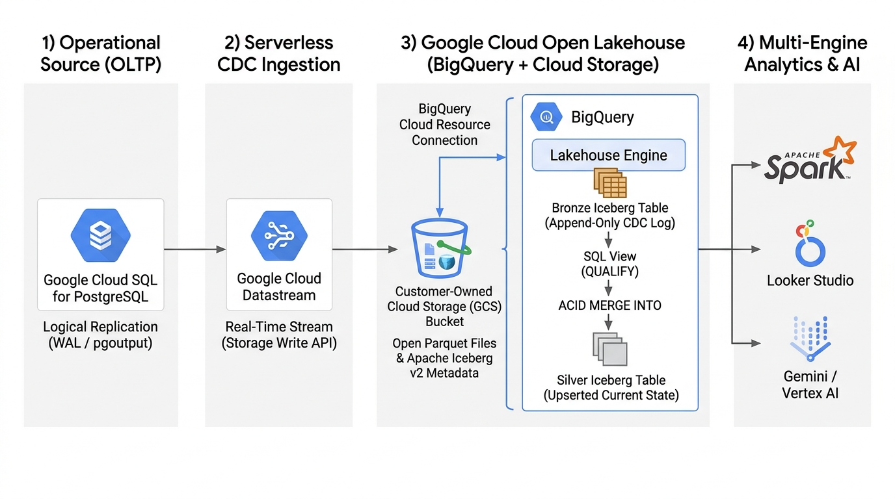

# Real-Time CDC to the Open Lakehouse: Streaming Cloud SQL (PostgreSQL) Changes into Apache Iceberg on GCP

*How to build a zero-lock-in Change Data Capture pipeline using Cloud SQL, Datastream, BigQuery Managed Iceberg Tables, and Cloud Storage—plus the real-world engineering patterns for turning Append-Only CDC logs into upserted Silver Iceberg tables.*


> **🖼️ [GAMBAR UTAMA / HERO IMAGE]:** Upload file `./cdc_postgresql_iceberg_architecture.jpg` di sini.
> - **Caption Gambar untuk Medium:** *Figure 1: End-to-end serverless CDC architecture streaming Cloud SQL for PostgreSQL changes into BigQuery Managed Apache Iceberg tables on Google Cloud Storage via Datastream.*

---

## Introduction: The Tension Between Real-Time CDC and Open Table Formats

Modern data engineering teams usually want two things that historically required painful trade-offs:
1. **Real-Time Operational Analytics (CDC):** Replicating `INSERT`, `UPDATE`, and `DELETE` transactions from operational PostgreSQL databases within seconds so business dashboards and AI agents never run on stale data.
2. **An Open Data Lakehouse Architecture:** Storing analytical tables in open formats—specifically **Apache Iceberg** backed by **Parquet** files in customer-owned **Google Cloud Storage (GCS)** buckets—so data is never locked into a single proprietary storage engine.

Traditionally, combining real-time PostgreSQL CDC with Apache Iceberg meant managing a complex, heavy stack: Debezium, Apache Kafka, Schema Registry, Spark Structured Streaming or Apache Flink, and custom compaction cron jobs to prevent the notorious Iceberg "small file problem."

With **Google Cloud Datastream** and **BigQuery Managed Tables for Apache Iceberg (BigLake)**, you can now stream PostgreSQL Write-Ahead Log (WAL) changes directly into governed Apache Iceberg tables in your own GCS bucket—completely serverless.

In this hands-on guide, we will build this pipeline end-to-end on Google Cloud and solve three real-world engineering nuances you will encounter in production:
- Configuring Cloud SQL for PostgreSQL logical decoding and Datastream `blmtConfig` (BigLake Managed Tables) via the `gcloud` CLI.
- Understanding why Datastream writes to Apache Iceberg in **Append-Only mode** (and how its `datastream_metadata` struct differs from native BigQuery Merge tables).
- Implementing both a **Zero-Latency Deduplicated View** and an atomic **ACID `MERGE INTO` Silver Iceberg Table** to handle row-level updates and deletes.

---

## Architecture Overview

Our pipeline consists of four layers:

1. **Operational Source (OLTP):** A **Cloud SQL for PostgreSQL 15** instance configured with `cloudsql.logical_decoding=on`, a `PUBLICATION`, and a `pgoutput` logical replication slot.
2. **Serverless CDC Ingestion:** **Google Cloud Datastream** reads the PostgreSQL WAL stream and writes via the BigQuery Storage Write API.
3. **Bronze Open Lakehouse Layer (`lakehouse_bronze.public_orders`):** Configured via Datastream's `blmtConfig` (`tableFormat: ICEBERG`, `fileFormat: PARQUET`), Datastream lands every change event (`INSERT`, `UPDATE-INSERT`, `UPDATE-DELETE`, `DELETE`) into an Apache Iceberg table stored in our GCS bucket via a **BigQuery Cloud Resource Connection**.
4. **Silver Current-State Layer (`lakehouse_silver`):**
   - **Pattern A (`v_orders_current`):** A real-time SQL View using `QUALIFY ROW_NUMBER()` that resolves the latest state per primary key on the fly.
   - **Pattern B (`lakehouse_silver.orders`):** A materialized Apache Iceberg table updated via BigQuery's native ACID `MERGE INTO` DML, with exported Iceberg V2 metadata (`metadata.json` & Avro manifest lists) ready for Apache Spark, Trino, or PyIceberg.

---

## Step 1: Provisioning the Open Lakehouse Foundation & Cloud SQL

First, let's define our environment variables and enable the required Google Cloud APIs (`sqladmin`, `datastream`, `bigquery`, `bigqueryconnection`, `biglake`, and `storage`):

```bash
export PROJECT_ID="your-gcp-project-id"
export REGION="us-central1"
export GCS_BUCKET="${PROJECT_ID}-iceberg-lakehouse"
export BQ_CONNECTION_ID="iceberg-gcs-connection"
export BQ_BRONZE_DATASET="lakehouse_bronze"
export BQ_SILVER_DATASET="lakehouse_silver"
export CLOUDSQL_INSTANCE="pg-cdc-source"
export PG_DATABASE="ecommerce"
export PG_USER="postgres"
export PG_PASSWORD="YourStrongPassword2026!"
```

### 1.1 Create the GCS Bucket & BigQuery Cloud Resource Connection
BigQuery Managed Iceberg tables require a **Cloud Resource Connection** whose service account has `roles/storage.admin` on your GCS bucket:

```bash
# Create the GCS bucket for Apache Iceberg data and metadata
gcloud storage buckets create "gs://${GCS_BUCKET}" \
  --project="${PROJECT_ID}" \
  --location="${REGION}" \
  --uniform-bucket-level-access

# Create the BigQuery Cloud Resource Connection
bq mk --connection \
  --connection_type=CLOUD_RESOURCE \
  --project_id="${PROJECT_ID}" \
  --location="${REGION}" \
  "${BQ_CONNECTION_ID}"

# Retrieve the Connection's Service Account and grant Storage Admin on the bucket
BQ_CONN_SA=$(bq show --format=json --connection "${PROJECT_ID}.${REGION}.${BQ_CONNECTION_ID}" \
  | python3 -c "import sys, json; print(json.load(sys.stdin)['cloudResource']['serviceAccountId'])")

gcloud storage buckets add-iam-policy-binding "gs://${GCS_BUCKET}" \
  --member="serviceAccount:${BQ_CONN_SA}" \
  --role="roles/storage.admin" \
  --project="${PROJECT_ID}"

# Create Bronze and Silver datasets in BigQuery
bq --location="${REGION}" mk --dataset "${PROJECT_ID}:${BQ_BRONZE_DATASET}"
bq --location="${REGION}" mk --dataset "${PROJECT_ID}:${BQ_SILVER_DATASET}"
```

### 1.2 Create the Cloud SQL for PostgreSQL Instance with Logical Decoding
> **Engineering Gotcha #1:** On Cloud SQL for PostgreSQL, the database flag that sets `wal_level = logical` is named **`cloudsql.logical_decoding=on`** (not `cloudsql.logical_replication=on`, which is used by AlloyDB).

We also dynamically fetch Datastream's regional static IPs so Datastream can connect to Cloud SQL:

```bash
DS_IPS=$(gcloud datastream locations fetch-static-ips "${REGION}" \
  --project="${PROJECT_ID}" \
  --format="value(staticIps)" | tr ';' ',' | tr '\n' ',' | sed 's/,$//')

gcloud sql instances create "${CLOUDSQL_INSTANCE}" \
  --project="${PROJECT_ID}" \
  --database-version=POSTGRES_15 \
  --edition=ENTERPRISE \
  --tier=db-custom-2-7680 \
  --region="${REGION}" \
  --root-password="${PG_PASSWORD}" \
  --database-flags=cloudsql.logical_decoding=on,max_replication_slots=10,max_wal_senders=10 \
  --authorized-networks="${DS_IPS}" \
  --storage-type=SSD \
  --storage-size=20GB

gcloud sql databases create "${PG_DATABASE}" \
  --instance="${CLOUDSQL_INSTANCE}" \
  --project="${PROJECT_ID}"
```

---

## Step 2: Preparing PostgreSQL Publication & Logical Replication Slot

Next, connect to the `ecommerce` database on Cloud SQL and create an operational `public.orders` table, insert 5 initial seed rows, create a PostgreSQL publication, and initialize a `pgoutput` logical replication slot:

```sql
-- 1. Create the operational `orders` table
CREATE TABLE IF NOT EXISTS public.orders (
    order_id VARCHAR(20) PRIMARY KEY,
    customer_id VARCHAR(50) NOT NULL,
    product_category VARCHAR(50) NOT NULL,
    order_status VARCHAR(30) NOT NULL,
    total_amount NUMERIC(12, 2) NOT NULL,
    shipping_city VARCHAR(50) NOT NULL,
    updated_at TIMESTAMPTZ NOT NULL DEFAULT CURRENT_TIMESTAMP
);

-- 2. Configure REPLICA IDENTITY DEFAULT so primary keys are logged on UPDATE/DELETE
ALTER TABLE public.orders REPLICA IDENTITY DEFAULT;

-- 3. Insert 5 seed orders (to test Datastream initial backfill into Iceberg)
INSERT INTO public.orders (order_id, customer_id, product_category, order_status, total_amount, shipping_city, updated_at)
VALUES
    ('ORD-1001', 'CUST-01', 'Electronics', 'PENDING',    450.00, 'Jakarta',   NOW() - INTERVAL '2 hours'),
    ('ORD-1002', 'CUST-02', 'Home Office', 'PROCESSING', 180.50, 'Surabaya',  NOW() - INTERVAL '90 minutes'),
    ('ORD-1003', 'CUST-03', 'Books',       'PENDING',     35.00, 'Bandung',   NOW() - INTERVAL '60 minutes'),
    ('ORD-1004', 'CUST-04', 'Gaming',      'SHIPPED',    890.00, 'Singapore', NOW() - INTERVAL '30 minutes'),
    ('ORD-1005', 'CUST-05', 'Audio',       'DELIVERED',  220.00, 'Jakarta',   NOW() - INTERVAL '15 minutes')
ON CONFLICT (order_id) DO NOTHING;

-- 4. Grant replication role and create Publication + Replication Slot
ALTER USER postgres WITH REPLICATION;
CREATE PUBLICATION datastream_iceberg_pub FOR TABLE public.orders;
SELECT pg_create_logical_replication_slot('datastream_iceberg_slot', 'pgoutput');
```

---

## Step 3: Configuring Datastream for BigQuery Apache Iceberg Tables (`blmtConfig`)

Now we create the Datastream Source and Destination Connection Profiles:

```bash
PG_PUBLIC_IP=$(gcloud sql instances describe "${CLOUDSQL_INSTANCE}" \
  --project="${PROJECT_ID}" \
  --format="value(ipAddresses[0].ipAddress)")

gcloud datastream connection-profiles create pg-source-profile \
  --location="${REGION}" \
  --project="${PROJECT_ID}" \
  --display-name="pg-source-profile" \
  --type=POSTGRESQL \
  --postgresql-hostname="${PG_PUBLIC_IP}" \
  --postgresql-port=5432 \
  --postgresql-username="${PG_USER}" \
  --postgresql-password="${PG_PASSWORD}" \
  --postgresql-database="${PG_DATABASE}" \
  --static-ip-connectivity

gcloud datastream connection-profiles create bq-iceberg-dest-profile \
  --location="${REGION}" \
  --project="${PROJECT_ID}" \
  --display-name="bq-iceberg-dest-profile" \
  --type=BIGQUERY \
  --static-ip-connectivity
```

### Configuring `blmtConfig` (BigLake Managed Tables for Apache Iceberg)
To instruct Datastream to create and stream into **Apache Iceberg tables** on GCS rather than proprietary BigQuery native storage, we pass a `blmtConfig` block inside `bigquery_iceberg_destination_config.json`.

> **Engineering Gotcha #2:** When configuring `blmtConfig` via the Datastream API/CLI:
> 1. `connectionName` must follow the compact `{project}.{location}.{name}` format (not the full `projects/.../locations/.../connections/...` resource URI).
> 2. `rootPath` must begin with a leading slash `/` (e.g., `"/bronze"`).
> 3. Streaming into Apache Iceberg tables requires `"appendOnly": {}` write mode.

```json
{
  "singleTargetDataset": {
    "datasetId": "YOUR_PROJECT_ID:lakehouse_bronze"
  },
  "appendOnly": {},
  "blmtConfig": {
    "bucket": "YOUR_PROJECT_ID-iceberg-lakehouse",
    "rootPath": "/bronze",
    "connectionName": "YOUR_PROJECT_ID.us-central1.iceberg-gcs-connection",
    "fileFormat": "PARQUET",
    "tableFormat": "ICEBERG"
  }
}
```

Create and start the stream:

```bash
gcloud datastream streams create pg-to-iceberg-cdc-stream \
  --location="${REGION}" \
  --project="${PROJECT_ID}" \
  --display-name="pg-to-iceberg-cdc-stream" \
  --source="pg-source-profile" \
  --postgresql-source-config="configs/postgresql_source_config.json" \
  --destination="bq-iceberg-dest-profile" \
  --bigquery-destination-config="configs/bigquery_iceberg_destination_config.json" \
  --backfill-all

# Once the stream reaches NOT_STARTED state, start it:
gcloud datastream streams update pg-to-iceberg-cdc-stream \
  --location="${REGION}" \
  --project="${PROJECT_ID}" \
  --state=RUNNING \
  --update-mask=state
```

---
> ### 📸 [LETAKKAN SCREENSHOT 1 DI SINI]
> - **File / Gambar yang Di-upload:** Screenshot halaman **Datastream Stream Details (`pg-to-iceberg-cdc-stream`)** yang menampilkan tulisan `PostgreSQL / Apache Iceberg tables in BigQuery`, `Storage URI: gs://.../bronze`, `Stream write mode: Append-only`, dan `Stream status: Running`. *(Sudah tersimpan juga di: `./screenshots/screenshot_1_datastream_running.png`)*
> - **Caption Gambar untuk Medium (Copy-Paste ke bawah gambar):**
>   *Figure 2: Google Cloud Datastream configured to stream PostgreSQL WAL changes directly into BigQuery Apache Iceberg tables on Cloud Storage in Append-Only mode.*
---

---

## Step 4: Simulating Real-Time OLTP Changes (`INSERT`, `UPDATE`, `DELETE`)

Once the initial 5 seed rows are backfilled into `lakehouse_bronze.public_orders`, let's simulate real-time operational transactions in PostgreSQL:
- **INSERT** 2 new orders (`ORD-1006` and `ORD-1007`)
- **UPDATE** `ORD-1001` (`PENDING` $\rightarrow$ `SHIPPED`) and `ORD-1002` (`PROCESSING` $\rightarrow$ `DELIVERED`, amount updated to `195.00`)
- **DELETE** cancelled order `ORD-1003`

```sql
INSERT INTO public.orders (order_id, customer_id, product_category, order_status, total_amount, shipping_city, updated_at)
VALUES
    ('ORD-1006', 'CUST-06', 'Smartphones', 'PENDING', 699.00, 'Jakarta',  NOW()),
    ('ORD-1007', 'CUST-07', 'Wearables',   'PAID',    149.90, 'Medan',    NOW());

UPDATE public.orders
SET order_status = 'SHIPPED', updated_at = NOW()
WHERE order_id = 'ORD-1001';

UPDATE public.orders
SET order_status = 'DELIVERED', total_amount = 195.00, updated_at = NOW()
WHERE order_id = 'ORD-1002';

DELETE FROM public.orders
WHERE order_id = 'ORD-1003';
```

### Inspecting the Bronze Apache Iceberg Change Log in BigQuery
> **Engineering Gotcha #3:** Unlike Datastream's `MERGE` mode (which adds a boolean `datastream_metadata.is_deleted` field), Datastream's **`APPEND_ONLY` mode for Apache Iceberg** uses the schema:
> `STRUCT<uuid STRING, source_timestamp INT64, change_sequence_number STRING, change_type STRING, sort_keys ARRAY<STRING>>`.
> Every mutation is recorded via **`datastream_metadata.change_type`** (`INSERT`, `UPDATE-INSERT`, `UPDATE-DELETE`, or `DELETE`).

Let's query our Bronze Iceberg table:

```sql
SELECT
  order_id,
  customer_id,
  order_status,
  total_amount,
  datastream_metadata.change_type,
  TIMESTAMP_MICROS(datastream_metadata.source_timestamp) AS source_ts,
  datastream_metadata.change_sequence_number AS csn
FROM `YOUR_PROJECT_ID.lakehouse_bronze.public_orders`
ORDER BY order_id, datastream_metadata.source_timestamp DESC, csn DESC;
```

---
> ### 📸 [LETAKKAN SCREENSHOT 2 DI SINI]
> - **File / Gambar yang Di-upload:** Screenshot hasil query **Tabel Bronze Iceberg (`lakehouse_bronze.public_orders`)** di BigQuery Console (atau terminal Cloud Shell langkah `[1/4]`) yang memperlihatkan kolom `change_type` berisi riwayat `INSERT`, `UPDATE-INSERT`, `UPDATE-DELETE`, dan `DELETE`.
> - **Caption Gambar untuk Medium (Copy-Paste ke bawah gambar):**
>   *Figure 3: Querying the Bronze Apache Iceberg table (`lakehouse_bronze.public_orders`) in BigQuery, showing the immutable CDC event log (`INSERT`, `UPDATE-INSERT`, `UPDATE-DELETE`, and `DELETE`) captured in `datastream_metadata`.*
---

---

## Step 5: Turning Append-Only Bronze into an Upserted Silver Iceberg Table

Because our Bronze Iceberg table is an immutable append-only change log, downstream BI tools and AI agents need a clean, deduplicated **Current State (Silver)** layer where updates overwrite older versions and `DELETE` events remove deleted records.

Here are the two production patterns you can use on Google Cloud:

### Pattern A: Zero-Latency Real-Time Deduplicated View
If you want zero replication delay between Bronze and Silver without storing a second copy of the data, create a view using `QUALIFY ROW_NUMBER()`:

```sql
CREATE OR REPLACE VIEW `YOUR_PROJECT_ID.lakehouse_silver.v_orders_current` AS
SELECT
  order_id,
  customer_id,
  product_category,
  order_status,
  total_amount,
  shipping_city,
  updated_at,
  TIMESTAMP_MICROS(datastream_metadata.source_timestamp) AS last_cdc_timestamp,
  datastream_metadata.change_type AS last_change_type
FROM `YOUR_PROJECT_ID.lakehouse_bronze.public_orders`
WHERE datastream_metadata.change_type != 'UPDATE-DELETE'
QUALIFY ROW_NUMBER() OVER (
  PARTITION BY order_id
  ORDER BY
    datastream_metadata.source_timestamp DESC,
    datastream_metadata.change_sequence_number DESC
) = 1
AND datastream_metadata.change_type != 'DELETE';
```

### Pattern B: Materialized Silver Apache Iceberg Table via ACID `MERGE INTO`
When external engines (like **Apache Spark**, **Trino**, or **PyIceberg**) need to read the curated Silver table directly from GCS without executing a BigQuery SQL view, or when your Bronze log grows to hundreds of millions of events, materialize a **Silver Managed Iceberg Table** and run an incremental `MERGE INTO`:

```sql
-- 1. Create the Silver Managed Apache Iceberg Table on GCS
CREATE TABLE IF NOT EXISTS `YOUR_PROJECT_ID.lakehouse_silver.orders` (
  order_id STRING,
  customer_id STRING,
  product_category STRING,
  order_status STRING,
  total_amount NUMERIC,
  shipping_city STRING,
  updated_at TIMESTAMP,
  last_cdc_timestamp TIMESTAMP
)
CLUSTER BY order_id
WITH CONNECTION `YOUR_PROJECT_ID.us-central1.iceberg-gcs-connection`
OPTIONS (
  file_format = 'PARQUET',
  table_format = 'ICEBERG',
  storage_uri = 'gs://YOUR_PROJECT_ID-iceberg-lakehouse/silver/orders'
);

-- 2. Execute Atomic ACID MERGE INTO (Upserts + Physical Deletes)
MERGE `YOUR_PROJECT_ID.lakehouse_silver.orders` AS T
USING (
  SELECT
    order_id,
    customer_id,
    product_category,
    order_status,
    total_amount,
    shipping_city,
    updated_at,
    TIMESTAMP_MICROS(datastream_metadata.source_timestamp) AS source_ts,
    datastream_metadata.change_type AS change_type
  FROM `YOUR_PROJECT_ID.lakehouse_bronze.public_orders`
  WHERE datastream_metadata.change_type != 'UPDATE-DELETE'
  QUALIFY ROW_NUMBER() OVER (
    PARTITION BY order_id
    ORDER BY
      datastream_metadata.source_timestamp DESC,
      datastream_metadata.change_sequence_number DESC
  ) = 1
) AS S
ON T.order_id = S.order_id
WHEN MATCHED AND S.change_type = 'DELETE' THEN
  DELETE
WHEN MATCHED THEN
  UPDATE SET
    customer_id        = S.customer_id,
    product_category   = S.product_category,
    order_status       = S.order_status,
    total_amount       = S.total_amount,
    shipping_city      = S.shipping_city,
    updated_at         = S.updated_at,
    last_cdc_timestamp = S.source_ts
WHEN NOT MATCHED AND S.change_type != 'DELETE' THEN
  INSERT (
    order_id, customer_id, product_category, order_status,
    total_amount, shipping_city, updated_at, last_cdc_timestamp
  )
  VALUES (
    S.order_id, S.customer_id, S.product_category, S.order_status,
    S.total_amount, S.shipping_city, S.updated_at, S.source_ts
  );

-- 3. Export Iceberg Metadata Snapshot for Multi-Engine Readers (Spark / PyIceberg)
EXPORT TABLE METADATA FROM `YOUR_PROJECT_ID.lakehouse_silver.orders`;
```

Querying `lakehouse_silver.orders` now returns the exact 6 active orders matching Cloud SQL (`ORD-1001` as `SHIPPED`, `ORD-1002` as `DELIVERED` at `195.00`, `ORD-1003` deleted, and `ORD-1006`/`ORD-1007` inserted)!

---
> ### 📸 [LETAKKAN SCREENSHOT 3 DI SINI]
> - **File / Gambar yang Di-upload:** Screenshot hasil query **Tabel Silver Iceberg (`SELECT * FROM lakehouse_silver.orders ORDER BY order_id`)** yang menampilkan **6 baris bersih** setelah `MERGE INTO` (dan/atau tab **Details** tabel yang memperlihatkan `Table format: ICEBERG` & `File format: PARQUET`).
> - **Caption Gambar untuk Medium (Copy-Paste ke bawah gambar):**
>   *Figure 4: The curated Silver Apache Iceberg table (`lakehouse_silver.orders`) after atomic ACID `MERGE INTO`, reflecting updated order statuses (`ORD-1001`, `ORD-1002`), newly inserted orders (`ORD-1006`, `ORD-1007`), and physical removal of deleted order `ORD-1003`.*
---

### Verifying Physical Open Parquet & Iceberg Metadata Files in Cloud Storage

Finally, let's verify that both our Bronze and Silver tables are stored as genuine open-format **Apache Iceberg** tables inside our customer-owned GCS bucket (`gs://${GCS_BUCKET}/`):

```bash
gcloud storage ls --recursive "gs://${GCS_BUCKET}/"
```

---
> ### 📸 [LETAKKAN SCREENSHOT 4 DI SINI]
> - **File / Gambar yang Di-upload:** Screenshot daftar file di **Cloud Storage Bucket (`gs://learning-gcp-369416-iceberg-lakehouse/`)** (bisa dari halaman GCS Browser di Console atau dari output terminal langkah `[4/4]`) yang memperlihatkan file `.parquet` di dalam folder `data/` serta file snapshot `.metadata.json` / `.avro` di dalam folder `metadata/`.
> - **Caption Gambar untuk Medium (Copy-Paste ke bawah gambar):**
>   *Figure 5: Inside our Google Cloud Storage bucket (`gs://.../bronze` and `gs://.../silver/orders`), verifying open Parquet data files and exported Apache Iceberg V2 metadata snapshots.*
---

---

## When to Use Pattern A (View) vs. Pattern B (Materialized Iceberg `MERGE`)

```text
+-----------------------------------+------------------------------------------+--------------------------------------------------------+
| Dimension                         | Pattern A: Deduplicated View (QUALIFY)   | Pattern B: Materialized Silver Iceberg (MERGE INTO)    |
+-----------------------------------+------------------------------------------+--------------------------------------------------------+
| Data Freshness                    | Instant (real-time as Datastream writes) | Near real-time (e.g., scheduled every 5-15 mins)       |
| Storage Cost                      | Single copy (Bronze only)                | Dual copy (Bronze audit log + Silver current state)    |
| Read Query Cost                   | Scans Bronze history on each query       | Scans only active, compacted Silver rows               |
| Multi-Engine Access (Spark/Trino) | Requires BigQuery SQL engine             | Direct open Iceberg read from GCS (gs://.../silver)    |
+-----------------------------------+------------------------------------------+--------------------------------------------------------+
```

- **Data Freshness:**
  - *Pattern A (`QUALIFY` View):* Instant, real-time freshness as soon as Datastream appends new events.
  - *Pattern B (Materialized `MERGE INTO`):* Near real-time, depending on your scheduled `MERGE` frequency (e.g., every 5–15 minutes).
- **Storage Cost:**
  - *Pattern A (`QUALIFY` View):* Single physical copy in GCS (Bronze only).
  - *Pattern B (Materialized `MERGE INTO`):* Dual copy in GCS (immutable Bronze audit log + compacted Silver current state).
- **Read Query Cost:**
  - *Pattern A (`QUALIFY` View):* Evaluates the window function across Bronze history on every read.
  - *Pattern B (Materialized `MERGE INTO`):* Scans only active, compacted Silver rows—ideal for high-concurrency BI dashboards.
- **Multi-Engine Interoperability (Spark / Trino / PyIceberg):**
  - *Pattern A (`QUALIFY` View):* Requires querying through the BigQuery SQL engine.
  - *Pattern B (Materialized `MERGE INTO`):* External engines can read the curated Silver Iceberg table directly from GCS (`gs://.../silver/orders`) via exported Iceberg metadata.

---

## Conclusion

By combining **Cloud SQL for PostgreSQL**, **Google Cloud Datastream**, and **BigQuery Managed Tables for Apache Iceberg**, you get the best of both worlds: a zero-maintenance, serverless CDC pipeline and an open Parquet/Iceberg lakehouse stored in your own Cloud Storage bucket.

You can find all the complete, reproducible bash and SQL scripts for this tutorial in my GitHub repository:
- **GitHub Repository:** [https://github.com/saipulrx/cdc_lakehouse_gcp](https://github.com/saipulrx/cdc_lakehouse_gcp)

*Built for the Google Cloud Lakehouse/Iceberg Content Sprint 2026 (`#AISprint`).*
