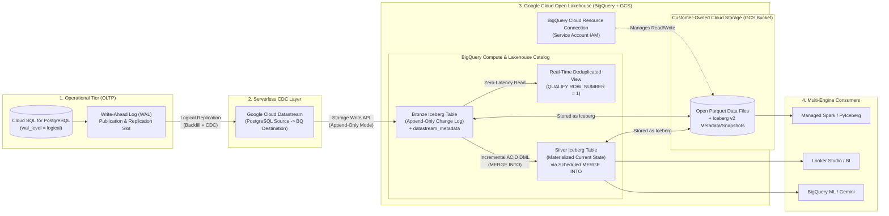
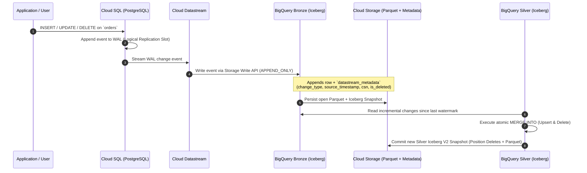

# Medium Article Outline & Architecture Guide

**Title:** Real-Time CDC to the Open Lakehouse: Streaming Cloud SQL (PostgreSQL) Changes into Apache Iceberg on GCP
**Subtitle:** How to build a zero-lock-in Change Data Capture pipeline using Cloud SQL, Datastream, BigQuery Managed Iceberg Tables, and Cloud Storage—plus how to handle the Append-Only to Upsert (Silver) pattern in production.
**Sprint Track:** Advanced ETL, CDC, and Streaming Lakehouse (*Implementing Real-Time CDC from PostgreSQL to Iceberg*)
**Target Persona:** Data Engineers, Database Engineers, Cloud Architects

---

## 1. End-to-End Architecture Diagrams

### A. High-Level System Architecture (Mermaid Flowchart)



### B. Data Flow & CDC Lifecycle (Sequence Diagram)



---

## 2. Important Technical Insight (The "Aha!" Moment of Your Article)

Saat Anda mengonfigurasi **Datastream** dengan target **BigQuery Apache Iceberg Table** (BigLake managed table), ada satu detail teknis krusial di Google Cloud yang akan membuat artikel Anda sangat berbobot dan berbeda dari dokumentasi biasa:

1. **Datastream ke Native BigQuery Table vs. BigQuery Iceberg Table:**
   - Pada **Native BigQuery Table**, Datastream mendukung mode **Upsert (`MERGE`)** secara otomatis di belakang layar (menggunakan primary key dan `max_staleness`).
   - Namun, ketika Anda mengaktifkan opsi **Apache Iceberg tables** (menyimpan data sebagai open Parquet di GCS melalui *BigQuery Cloud Resource Connection*), Datastream **hanya mendukung mode `APPEND_ONLY`** (Write-Append).
2. **Bagaimana Cara Membuat Tabel Iceberg Tetap *Up-to-Date* (Ter-Upsert/Delete)?**
   - Setiap perubahan di PostgreSQL (`INSERT`, `UPDATE`, `DELETE`) akan ditulis oleh Datastream sebagai baris baru di tabel **Bronze Iceberg** dengan kolom metadata `datastream_metadata` (`change_type`, `source_timestamp`, `change_sequence_number`, `is_deleted`).
   - Di artikel ini, Anda akan menunjukkan **2 pola produksi** di atas tabel Bronze Iceberg tersebut:
     - **Pola 1 (Zero-Latency Virtual Current State):** Membuat SQL View dengan `QUALIFY ROW_NUMBER() OVER (...) = 1` yang langsung menyaring state terakhir dan membuang baris dengan `is_deleted = TRUE`.
     - **Pola 2 (Materialized Silver Iceberg Table):** Menjalankan query `MERGE INTO` di BigQuery dari tabel Bronze Iceberg ke tabel Silver Iceberg (karena BigQuery Managed Iceberg mendukung penuh GoogleSQL DML `MERGE`, `UPDATE`, `DELETE` serta *automatic compaction*).

---

## 3. Structured Medium Article Outline

### Section 1: Introduction — The Tension Between Real-Time CDC and Open Formats
- **Hook:** Tim data modern menginginkan dua hal yang sering terlihat bertolak belakang: *real-time operational analytics* (CDC dari PostgreSQL dengan latensi rendah) dan *open lakehouse architecture* (menyimpan data dalam format terbuka Apache Iceberg di bucket GCS sendiri tanpa vendor lock-in).
- **The Old Way vs. The New Way:**
  - *Cara Lama:* Setup cluster Kafka + Debezium + Spark Streaming/Flink + Hive Metastore secara manual (operasional berat, rawan *small file problem*, dan *out-of-memory*).
  - *Cara Baru di GCP:* Menggunakan **Cloud Datastream** (serverless CDC) yang langsung mengalirkan perubahan dari **Cloud SQL for PostgreSQL** ke **BigQuery Tables for Apache Iceberg** di atas **Google Cloud Storage (GCS)**.
- **What Readers Will Learn:** Arsitektur end-to-end, konfigurasi logical replication PostgreSQL, koneksi BigQuery Iceberg ke GCS, serta trik mengatasi limitasi *Append-Only* pada Datastream Iceberg menjadi tabel Silver yang siap pakai.

### Section 2: Architecture Overview & How It Works Under the Hood
- Tampilkan **Diagram Arsitektur** (di atas).
- Jelaskan peran 4 komponen utama:
  1. **Cloud SQL for PostgreSQL:** Sumber OLTP dengan `cloudsql.logical_decoding = on`.
  2. **BigQuery Cloud Resource Connection & GCS Bucket:** Jembatan identitas IAM yang memungkinkan BigQuery dan Datastream menulis file Parquet dan metadata Iceberg ke bucket GCS milik Anda.
  3. **Cloud Datastream:** Mesin CDC serverless yang membaca *Write-Ahead Log (WAL)* tanpa membebani CPU database utama.
  4. **BigQuery Managed Iceberg Runtime:** Mengelola tabel Iceberg (otomatis menangani file compaction, snapshot expiration, dan mendukung DML `MERGE`).

### Section 3: Step 1 — Preparing Cloud SQL for PostgreSQL for Logical CDC
- Aktifkan flag `cloudsql.logical_decoding = on`.
- Buat tabel simulasi bisnis (misalnya tabel `orders` atau `shipments`) dan isi data awal.
- Konfigurasi PostgreSQL Publication & Replication Slot:
  ```sql
  -- 1. Buat tabel operasional
  CREATE TABLE public.orders (
      order_id SERIAL PRIMARY KEY,
      customer_id VARCHAR(50) NOT NULL,
      order_status VARCHAR(30) NOT NULL,
      total_amount NUMERIC(12, 2) NOT NULL,
      updated_at TIMESTAMPTZ DEFAULT CURRENT_TIMESTAMP
  );

  -- 2. Pastikan REPLICA IDENTITY DEFAULT (atau FULL jika tanpa PK)
  ALTER TABLE public.orders REPLICA IDENTITY DEFAULT;

  -- 3. Buat Publication untuk Datastream
  CREATE PUBLICATION datastream_iceberg_pub FOR TABLE public.orders;

  -- 4. Buat Logical Replication Slot (pgoutput)
  SELECT PG_CREATE_LOGICAL_REPLICATION_SLOT('datastream_iceberg_slot', 'pgoutput');
  ```

### Section 4: Step 2 — Setting Up the Open Lakehouse Foundation (GCS + BigQuery Connection)
- Buat bucket GCS untuk menyimpan file Parquet dan metadata Apache Iceberg.
- Buat **BigQuery Cloud Resource Connection** dan berikan akses `roles/storage.admin` pada bucket GCS:
  ```bash
  # 1. Buat bucket GCS untuk Iceberg Lakehouse
  gcloud storage buckets create gs://YOUR_PROJECT_ID-iceberg-lakehouse \
    --location=us-central1 \
    --uniform-bucket-level-access

  # 2. Buat BigQuery Cloud Resource Connection
  bq mk --connection \
    --location=us-central1 \
    --project_id=YOUR_PROJECT_ID \
    --connection_type=CLOUD_RESOURCE \
    iceberg-gcs-connection

  # 3. Lihat Service Account dari Connection tersebut
  bq show --connection YOUR_PROJECT_ID.us-central1.iceberg-gcs-connection
  ```
- Berikan role Storage Admin ke Service Account connection tersebut di bucket GCS.

### Section 5: Step 3 — Configuring Datastream to Stream into BigQuery Iceberg Tables
- Buat **Source Connection Profile** (Cloud SQL PostgreSQL) dan **Destination Connection Profile** (BigQuery).
- Saat membuat **Stream** di Datastream, tunjukkan konfigurasi kunci pada bagian **BigQuery Destination Settings**:
  - Pilih **Dataset configuration** $\rightarrow$ Aktifkan **BigLake tables for Apache Iceberg** (masukkan GCS bucket prefix `gs://YOUR_PROJECT_ID-iceberg-lakehouse/bronze/` dan Cloud Resource Connection `iceberg-gcs-connection`).
  - Pilih **Write mode:** `Append-only` (jelaskan mengapa opsi *Upsert/Merge* dikunci saat memilih Apache Iceberg, dan mengapa *Append-only* justru bagus sebagai *immutable audit log* di layer Bronze).

### Section 6: Step 4 — Testing Real-Time Mutations (INSERT, UPDATE, DELETE)
- Jalankan transaksi `INSERT`, `UPDATE` (misal status order berubah dari `PENDING` ke `SHIPPED`), dan `DELETE` di Cloud SQL PostgreSQL.
- Query tabel Bronze Iceberg di BigQuery dan perlihatkan isi kolom `datastream_metadata`:
  ```sql
  SELECT
    order_id,
    customer_id,
    order_status,
    total_amount,
    datastream_metadata.change_type,
    datastream_metadata.is_deleted,
    datastream_metadata.source_timestamp,
    datastream_metadata.change_sequence_number
  FROM `YOUR_PROJECT_ID.lakehouse_bronze.public_orders`
  ORDER BY order_id, datastream_metadata.source_timestamp DESC;
  ```
- Tunjukkan juga bukti di **Google Cloud Storage (GCS)** bahwa file yang terbentuk benar-benar file terbuka `.parquet` dan folder `metadata/` Apache Iceberg!

### Section 7: Step 5 — From Append-Only Bronze to Upserted Silver Iceberg Table
Ini adalah bagian *best-practice engineering* yang paling disukai pembaca Medium:
- **Pendekatan A: Real-Time Deduplicated View (Zero Storage Duplication)**
  ```sql
  CREATE OR REPLACE VIEW `YOUR_PROJECT_ID.lakehouse_silver.v_orders_current` AS
  SELECT
    order_id,
    customer_id,
    order_status,
    total_amount,
    updated_at,
    datastream_metadata.source_timestamp AS last_cdc_timestamp
  FROM `YOUR_PROJECT_ID.lakehouse_bronze.public_orders`
  QUALIFY ROW_NUMBER() OVER (
    PARTITION BY order_id
    ORDER BY
      datastream_metadata.source_timestamp DESC,
      datastream_metadata.change_sequence_number DESC
  ) = 1
  AND IFNULL(datastream_metadata.is_deleted, FALSE) = FALSE;
  ```
- **Pendekatan B: Materialized Silver Apache Iceberg Table (ACID `MERGE INTO`)**
  - Buat tabel Silver Managed Iceberg (`TABLE_FORMAT = 'ICEBERG'`) di GCS.
  - Jalankan query `MERGE INTO` yang menerapkan *upsert* dan *hard/soft delete* dari perubahan terbaru di tabel Bronze ke tabel Silver:
  ```sql
  -- 1. Buat Silver Managed Iceberg Table
  CREATE TABLE `YOUR_PROJECT_ID.lakehouse_silver.orders` (
    order_id INT64,
    customer_id STRING,
    order_status STRING,
    total_amount NUMERIC,
    updated_at TIMESTAMP,
    last_cdc_timestamp TIMESTAMP
  )
  CLUSTER BY order_id
  WITH CONNECTION `YOUR_PROJECT_ID.us-central1.iceberg-gcs-connection`
  OPTIONS (
    file_format = 'PARQUET',
    table_format = 'ICEBERG',
    storage_uri = 'gs://YOUR_PROJECT_ID-iceberg-lakehouse/silver/orders'
  );

  -- 2. Atomic MERGE INTO dari Bronze CDC Log ke Silver Iceberg Table
  MERGE `YOUR_PROJECT_ID.lakehouse_silver.orders` AS T
  USING (
    SELECT *
    FROM `YOUR_PROJECT_ID.lakehouse_bronze.public_orders`
    -- Di produksi: tambahkan filter watermark waktu agar hanya memproses delta terbaru
    QUALIFY ROW_NUMBER() OVER (
      PARTITION BY order_id
      ORDER BY
        datastream_metadata.source_timestamp DESC,
        datastream_metadata.change_sequence_number DESC
    ) = 1
  ) AS S
  ON T.order_id = S.order_id
  WHEN MATCHED AND S.datastream_metadata.is_deleted = TRUE THEN
    DELETE
  WHEN MATCHED THEN
    UPDATE SET
      customer_id = S.customer_id,
      order_status = S.order_status,
      total_amount = S.total_amount,
      updated_at = S.updated_at,
      last_cdc_timestamp = S.datastream_metadata.source_timestamp
  WHEN NOT MATCHED AND IFNULL(S.datastream_metadata.is_deleted, FALSE) = FALSE THEN
    INSERT (order_id, customer_id, order_status, total_amount, updated_at, last_cdc_timestamp)
    VALUES (S.order_id, S.customer_id, S.order_status, S.total_amount, S.updated_at, S.datastream_metadata.source_timestamp);
  ```

### Section 8: Proving Openness — Time Travel & Multi-Engine Access
- Tunjukkan bagaimana kita bisa melakukan **Time Travel (`FOR SYSTEM_TIME AS OF`)** pada tabel Silver Iceberg untuk melihat state order sebelum di-update/delete.
- Tunjukkan bahwa metadata Iceberg di GCS (`EXPORT TABLE METADATA`) memungkinkan engine lain seperti **Apache Spark** atau **PyIceberg** membaca tabel yang sama tanpa menyalin data (*zero-copy*).

### Section 9: Production Best Practices & Trade-offs (FinOps & Latency)
- Kapan cukup memakai **Deduplicated View** vs. kapan harus memakai **Materialized Silver Iceberg (`MERGE INTO`)**? (Buat tabel perbandingan: *Query Cost*, *Freshness/Latency*, *Multi-Engine Compatibility*).
- Monitoring *Replication Slot WAL growth* di Cloud SQL agar disk PostgreSQL tidak penuh jika stream dijeda.

### Section 10: Conclusion & Takeaways
- Ringkasan bagaimana kombinasi **Cloud SQL + Datastream + BigQuery Managed Iceberg + GCS** menghilangkan kompleksitas Kafka/Debezium sekaligus menjaga data tetap 100% terbuka dalam format Apache Iceberg.
- Link ke GitHub Repository untuk script Terraform/gcloud & SQL.
